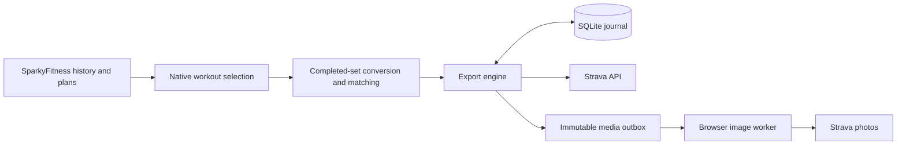

# Architecture

## Overview

The source layer resolves native preset/plan sessions before the export engine constructs Strava uploads. Media runs as a separate file-queue consumer.



## Components

### Source selection

`source.py` checks native provenance, keeps grouped instances separate and resolves ungrouped plan assignments by template, schedule, slot and diary date. Missing source evidence and unresolved assignments are excluded rather than guessed.

### Conversion and exercise matching

`workout.py` keeps completed sets, validates stored kg loads and timing, and creates UTC timestamps. `mapping.py` prioritizes manual UUID overrides, then catalog and library-alias matching. Unsupported completed sets block the whole export.

### Engine and state

`engine.py` binds accounts, fingerprints plans, tracks overlapping source entries, journals intent and polls asynchronous jobs. `state.py` locks SQLite, storing JSON settings and per-session export records. Source overlap prevents regrouping an exported workout from silently creating a new activity.

### Media

The queue snapshots exact exported sets and completed-exercise muscle metadata. The browser worker renders cards locally, validates athlete/activity identity, and writes receipts around browser mutations. It reads shared files without opening the core database.

## Data flow

`preview` reads the source identity, persists the boundary, fetches history and required plan templates, selects workouts, resolves mappings and validates timing. `sync` polls existing jobs first and submits eligible plans. A confirmed activity ID queues cards when media was enabled for that export. Later completed sets or source edits report `changed` rather than rewriting the activity.

## Directory layout

```text
src/sparkyfitness_strava/       Source, mapping, conversion, API, engine and CLI
src/sparkyfitness_strava/media/ Queue, worker, artwork and muscle metadata
tests/                         Source/alias/unit/release/integration tests
tests/media/                   Chromium worker and mock-site fixtures
examples/                      Existing-stack overlay and released media Compose
design/                        Historical design and validation notes
```

Inspect the plan with `docker compose -f compose.build.yaml run --rm connector preview` before running `sync`. See [usage](usage.md) for selection and recovery details.
